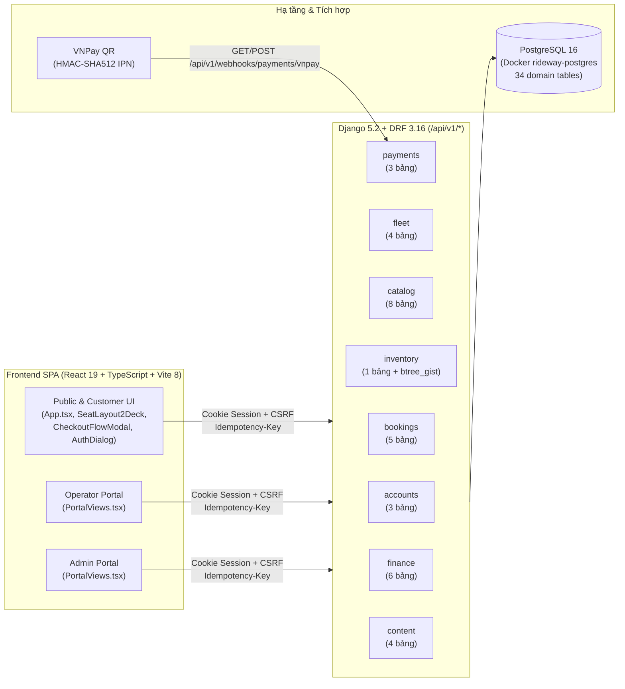

# 01 — BÁO CÁO HIỆN TRẠNG HỆ THỐNG (SYSTEM AUDIT)

**Dự án:** RideWay – Vé Xuyên Việt (Multi-Operator Long-Distance Bus Ticket Marketplace)  
**Repository:** `https://github.com/lethanhvu005/RideWay`  
**Thư mục mã nguồn:** `c:\ProjectCV\RideWay`  
**Ngày kiểm toán:** 2026-11-25  
**Phạm vi kiểm toán:** Toàn bộ `backend/`, `frontend/`, `docker-compose.yml`, `.specify/`, `specs/` (SRS, ERD, Data Dictionary, OpenAPI v1).

---

## 1. TỔNG QUAN KIẾN TRÚC HIỆN TẠI

RideWay – Vé Xuyên Việt là nền tảng Marketplace đặt vé xe khách đường dài đa nhà xe (Multi-Operator), tập trung vào nghiệp vụ cốt lõi:
- Bán vé theo từng **đoạn chặng trung gian** `[from_sequence, to_sequence)` trên tuyến nhiều điểm dừng (`A → B → C → D`).
- Quản lý tồn kho từng vị trí vật lý (**Phòng đôi Limousine `CABIN` 2 người lớn + 1 trẻ em** và **Giường đơn `BERTH` 1 người**) trên sơ đồ xe 2 tầng (`SeatLayout`, `LayoutUnit`, `TripUnit`).
- Giữ nhiều vị trí nguyên tử (**All-or-Nothing Atomic Multi-Unit Hold**) trong 10 phút bằng PostgreSQL `IntegerRangeField` + `ExclusionConstraint` (`btree_gist`).
- Thanh toán 100% giá trị đơn qua **VNPay QR** (Webhook/IPN HMAC-SHA512 idempotent) và phát hành vé điện tử QR theo tỉ lệ `1 BookingItem = 1 Ticket`.
- Ba cổng giao diện tách biệt trên cùng SPA: **Public & Customer Portal** (`PUBLIC`, `MY_TICKETS`), **Operator Portal** (`OPERATOR`), và **Platform Admin Portal** (`ADMIN`).

---

## 2. PHÂN LOẠI 3 TRẠNG THÁI TOÀN HỆ THỐNG

Theo quy tắc kiểm toán nghiêm ngặt, mọi hạng mục được phân biệt rõ theo 3 trạng thái:
1. **Đã có mã nguồn (Coded):** Đã lập trình Model/View/UI nhưng chưa có bài kiểm thử tự động chứng minh hoặc còn thiếu ràng buộc phụ.
2. **Đã kiểm thử thành công (Verified/Tested):** Có bằng chứng thực thi kiểm thử thực tế trên PostgreSQL 16 (`manage.py test bookings`) hoặc trình biên dịch (`tsc -b && vite build`).
3. **Chưa hoàn thiện (Incomplete):** Thiếu logic nghiệp vụ, sai lệch so với SRS/OpenAPI, thiếu validation, thiếu phân quyền hoặc lộ rủi ro bảo mật.

### 2.1. Tổng hợp trạng thái các phân hệ chính

| Phân hệ | Thành phần mã nguồn | Trạng thái | Bằng chứng thực tế |
|---|---|---|---|
| **Cơ sở dữ liệu PostgreSQL 16** | [docker-compose.yml](file:///c:/ProjectCV/RideWay/docker-compose.yml#L1-L21), 8 bộ migrations (`0001_initial.py`), `btree_gist` | **Đã kiểm thử thành công** | Container `rideway-postgres` (cổng `5432`) đã migrate 34 bảng nghiệp vụ và nạp dữ liệu mẫu qua [seed_demo_data.py](file:///c:/ProjectCV/RideWay/backend/accounts/management/commands/seed_demo_data.py#L1-L398). |
| **Chống trùng chỗ theo chặng (`[from_seq, to_seq)`)** | [inventory/models.py](file:///c:/ProjectCV/RideWay/backend/inventory/models.py#L18-L49), [bookings/services.py](file:///c:/ProjectCV/RideWay/backend/bookings/services.py#L51-L162) | **Đã kiểm thử thành công** | `AcceptanceMultiAppTests` trong [bookings/tests.py](file:///c:/ProjectCV/RideWay/backend/bookings/tests.py#L70-L118) chạy pass `T01` (trùng chặng `[0,2)` vs `[1,3)`), `T02` (liền kề `[0,1)` và `[1,2)`), `T03` (rollback giữ 3 phòng khi 1 phòng xung đột), `T04` (thu hồi hold quá hạn). |
| **Xác thực & Quản lý tài khoản (`accounts`)** | [accounts/models.py](file:///c:/ProjectCV/RideWay/backend/accounts/models.py#L1-L68), [accounts/views.py](file:///c:/ProjectCV/RideWay/backend/accounts/views.py#L1-L252) | **Chưa hoàn thiện (Lỗi bảo mật P0)** | Đăng ký/Đăng nhập session hoạt động, nhưng `PasswordResetRequestView` ([accounts/views.py](file:///c:/ProjectCV/RideWay/backend/accounts/views.py#L89-L92)) và `EmailVerificationRequestView` ([accounts/views.py](file:///c:/ProjectCV/RideWay/backend/accounts/views.py#L121-L127)) trả trực tiếp `uid` và `token` trong JSON response thay vì gửi qua email. |
| **Tìm kiếm chuyến & Giá theo chặng (`catalog`)** | [catalog/views.py](file:///c:/ProjectCV/RideWay/backend/catalog/views.py#L43-L88) | **Chưa hoàn thiện (Lỗi nghiệp vụ P0)** | `TripSearchView` lọc `from_location_id` và `to_location_id` độc lập, chưa kiểm tra chiều chạy `from_stop.sequence < to_stop.sequence` ([catalog/views.py](file:///c:/ProjectCV/RideWay/backend/catalog/views.py#L56-L61)) và tính `min_price = Min('tripfare__base_amount')` trên toàn chuyến thay vì đúng chặng tìm kiếm ([catalog/views.py](file:///c:/ProjectCV/RideWay/backend/catalog/views.py#L64)). |
| **Thanh toán VNPay & Vé điện tử QR (`payments`)** | [payments/services.py](file:///c:/ProjectCV/RideWay/backend/payments/services.py#L31-L210), [payments/views.py](file:///c:/ProjectCV/RideWay/backend/payments/views.py#L1-L103) | **Chưa hoàn thiện (Lỗi QR Token P0)** | Idempotency 3 lần gọi IPN đã pass test (`T05` tại [bookings/tests.py](file:///c:/ProjectCV/RideWay/backend/bookings/tests.py#L119-L130)). Tuy nhiên `process_vnpay_ipn` băm `raw_token` ra `qr_token_hash` rồi vứt bỏ `raw_token`, sau đó `MyTicketsView` trả trực tiếp `qr_token_hash` cho client và `check_in_ticket` cho phép đối chiếu thẳng chuỗi 64 ký tự hex với `qr_token_hash` ([payments/services.py](file:///c:/ProjectCV/RideWay/backend/payments/services.py#L174-L194)). |
| **Tài chính, Hủy vé & Đối soát (`finance`)** | [finance/models.py](file:///c:/ProjectCV/RideWay/backend/finance/models.py#L1-L129), [finance/views.py](file:///c:/ProjectCV/RideWay/backend/finance/views.py#L1-L212) | **Chưa hoàn thiện** | Đã kiểm thử chặn duyệt đối soát khi thiếu `CommissionAgreement` (`T11`) và gửi yêu cầu hủy (`T12`). Tuy nhiên khi Admin duyệt hủy vé (`AdminCancellationDecisionView` tại [finance/views.py](file:///c:/ProjectCV/RideWay/backend/finance/views.py#L159-L188)), hệ thống chưa giải phóng `InventoryAllocation` (`CONFIRMED → RELEASED`), chưa đổi trạng thái `Ticket` sang `CANCELLED` và chưa đổi `Booking.status` sang `CANCELLED`. |
| **Giao diện Frontend React 19 + TypeScript** | [frontend/src/App.tsx](file:///c:/ProjectCV/RideWay/frontend/src/App.tsx#L1-L1183), `components/*`, `styles/*` | **Đã có mã nguồn (Build Pass, thiếu Router/RTK)** | `tsc -b && vite build` biên dịch thành công, giao diện responsive lấy cảm hứng từ MONA Tour / GoWilds. Chưa cài đặt `react-router-dom` và `@reduxjs/toolkit` (RTK Query); toàn bộ điều hướng đang dùng state `activePortal` trong 1 trang đơn ([frontend/package.json](file:///c:/ProjectCV/RideWay/frontend/package.json#L12-L24)). |

---

## 3. ĐỐI CHIẾU TÀI LIỆU ĐẶC TẢ (SRS / SPEC KIT) VỚI MÃ NGUỒN THỰC TẾ

Hệ thống sở hữu bộ hồ sơ thiết kế rất đầy đủ trong `.specify/` và `specs/`:
- Hiến pháp dự án (Constitution v2.2.0): [.specify/memory/constitution.md](file:///c:/ProjectCV/RideWay/.specify/memory/constitution.md)
- Đặc tả hệ thống tổng thể & 8 phân hệ (`001`..`009`): [specs/001-bus-ticket-marketplace/spec.md](file:///c:/ProjectCV/RideWay/specs/001-bus-ticket-marketplace/spec.md), [data-model.md](file:///c:/ProjectCV/RideWay/specs/001-bus-ticket-marketplace/data-model.md), [openapi.yaml](file:///c:/ProjectCV/RideWay/specs/001-bus-ticket-marketplace/contracts/openapi.yaml).

### Bảng sai lệch giữa Tài liệu đặc tả và Mã nguồn thực tế

| Hạng mục | Quy định trong Tài liệu (`specs/` & `constitution.md`) | Thực tế trong Mã nguồn (`backend/` & `frontend/`) | Mức độ nghiêm trọng |
|---|---|---|---|
| **1. Giá thấp nhất khi tìm kiếm chuyến (`FR-06`, `BR-05`)** | Giá hiển thị trên kết quả tìm kiếm phải là giá của đúng đoạn `[from_sequence, to_sequence)` được tìm kiếm; tuyệt đối không lấy giá chặng khác. | [catalog/views.py](file:///c:/ProjectCV/RideWay/backend/catalog/views.py#L64) dùng `qs.distinct().annotate(min_price=Min('tripfare__base_amount'))` lấy giá nhỏ nhất của bất kỳ chặng phụ nào trên chuyến xe. | **P0 (Critical)** |
| **2. Chiều di chuyển giữa điểm đi và điểm đến (`FR-05`)** | Chỉ trả về chuyến xe có điểm đi xuất hiện **trước** điểm đến (`from_stop.sequence < to_stop.sequence`) và `allow_pickup=True` / `allow_dropoff=True`. | [catalog/views.py](file:///c:/ProjectCV/RideWay/backend/catalog/views.py#L56-L61) chỉ lọc `.filter(stops__route_stop__location_id=from_loc)` và `.filter(stops__route_stop__location_id=to_loc)` mà không so sánh thứ tự `sequence` hay cờ `allow_pickup`/`allow_dropoff`. | **P0 (Critical)** |
| **3. Bảo mật Token đặt lại mật khẩu & xác minh email (`FR-01`)** | Gửi liên kết/token qua kênh Email bất đồng bộ (Transactional Outbox); không tiết lộ token ra HTTP response. | [accounts/views.py](file:///c:/ProjectCV/RideWay/backend/accounts/views.py#L89-L92) và [L121-L127](file:///c:/ProjectCV/RideWay/backend/accounts/views.py#L121-L127) trả thẳng `{"uid": uid, "token": token}` trong JSON response của API công khai `AllowAny`. | **P0 (Critical Security)** |
| **4. Cơ chế lưu và quét mã QR vé điện tử (`FR-11`, `BR-06`)** | DB chỉ lưu `qr_token_hash` (SHA-256), vé điện tử của khách hiển thị `qr_token` gốc (hoặc chuỗi ký số), khi soát vé hệ thống băm `qr_token` để so khớp với `qr_token_hash`. | [payments/services.py](file:///c:/ProjectCV/RideWay/backend/payments/services.py#L174-L194) không trả/lưu `raw_token` lúc xuất vé, mà trả `qr_token_hash` qua `/api/v1/me/tickets` ([payments/views.py](file:///c:/ProjectCV/RideWay/backend/payments/views.py#L84)) và nhận trực tiếp chuỗi 64 ký tự `qr_token_hash` khi check-in. | **P0 (Critical Security)** |
| **5. Giải phóng chỗ sau khi duyệt hủy vé (`FR-13`)** | Khi yêu cầu hủy vé được phê duyệt, đơn vé chuyển sang `CANCELLED`, vé điện tử bị vô hiệu hóa (`CANCELLED`) và tồn kho `InventoryAllocation` chuyển sang `RELEASED` để mở bán lại. | [finance/views.py](file:///c:/ProjectCV/RideWay/backend/finance/views.py#L166-L188) mới chỉ đổi `CancellationRequest.status = 'APPROVED'` và tạo bản ghi `Refund`, chưa giải phóng `InventoryAllocation`, `Ticket` và `Booking`. | **P0 (High Data Integrity)** |
| **6. Vai trò Nhân viên vận hành nền tảng (`Platform Staff`, `S-01`)** | Tách biệt rõ 4 vai trò: Customer, Operator (`OWNER`/`MANAGER`/`CHECKIN`), Platform Staff (`is_staff=True`), Platform Admin (`is_superuser=True`). | `IsPlatformStaffOrAdmin` đã khai báo tại [common/__init__.py](file:///c:/ProjectCV/RideWay/backend/common/__init__.py#L71-L78) nhưng **không được gắn vào bất kỳ View nào**. Mọi endpoint `/admin/*` đều yêu cầu `IsPlatformAdmin` (`is_superuser`). | **P1 (Architecture/RBAC)** |
| **7. Transactional Outbox (`outbox_events`)** | Mọi sự kiện phát hành vé, giữ chỗ, hủy vé, đặt lại mật khẩu ghi vào bảng `outbox_events` trong cùng transaction DB để worker gửi email. | Bảng `outbox_events` đã tạo trong [content/models.py](file:///c:/ProjectCV/RideWay/backend/content/models.py#L46-L54) nhưng chưa có service nào ghi bản ghi vào bảng này khi phát sinh giao dịch thật. | **P1 (Reliability)** |
| **8. Kiến trúc Frontend Routing & State** | Phân tách URL rõ ràng (`P-01`..`P-11`, `O-01`..`O-06`, `S-01`, `A-01`..`A-04`) và quản lý cache API tập trung. | [frontend/package.json](file:///c:/ProjectCV/RideWay/frontend/package.json#L12-L24) mới chỉ cài `react` và `react-dom`; chưa có `react-router-dom`, `@reduxjs/toolkit`, `react-redux`. | **P1 (Frontend Architecture)** |

---

## 4. ĐÁNH GIÁ HẠ TẦNG, CẤU HÌNH & KIỂM THỬ

### 4.1. Cấu hình Django & Bảo mật ([backend/backend/settings.py](file:///c:/ProjectCV/RideWay/backend/backend/settings.py))
- **Điểm mạnh:**
  - Đã cấu hình PostgreSQL 16 qua biến môi trường (`POSTGRES_DB`, `POSTGRES_USER`, `POSTGRES_PASSWORD`, `POSTGRES_HOST`, `POSTGRES_PORT`) tại [settings.py](file:///c:/ProjectCV/RideWay/backend/backend/settings.py#L84-L95).
  - Đã bật `SESSION_COOKIE_HTTPONLY = True`, `CSRF_COOKIE_SAMESITE = 'Lax'`, `SESSION_COOKIE_SAMESITE = 'Lax'` và `custom_exception_handler` trả về `request_id` chuẩn hóa ([settings.py](file:///c:/ProjectCV/RideWay/backend/backend/settings.py#L68-L78), [L153-L162](file:///c:/ProjectCV/RideWay/backend/backend/settings.py#L153-L162)).
- **Điểm yếu cần khắc phục:**
  - `SECRET_KEY` và `VNPAY_HASH_SECRET` có giá trị fallback mặc định dành cho dev trong mã nguồn ([settings.py](file:///c:/ProjectCV/RideWay/backend/backend/settings.py#L16-L18), [L168](file:///c:/ProjectCV/RideWay/backend/backend/settings.py#L168)); cần bắt buộc đọc từ biến môi trường khi `DEBUG=False`.
  - Chưa cấu hình `DEFAULT_THROTTLE_CLASSES` và `DEFAULT_THROTTLE_RATES` trong `REST_FRAMEWORK` để chống brute-force đăng nhập, spam tạo hold hoặc dò mã vé.
  - Chưa cấu hình Celery / Redis hoặc Django management command chạy định kỳ để thu hồi hold quá hạn (`reclaim_expired_holds`) và đẩy sự kiện `OutboxEvent`.

### 4.2. Hạ tầng Docker ([docker-compose.yml](file:///c:/ProjectCV/RideWay/docker-compose.yml))
- Hiện tại `docker-compose.yml` mới chỉ đóng gói container `postgres:16-alpine` (`rideway-postgres`) với `healthcheck` `pg_isready` và volume `rideway_pgdata`.
- Chưa có `Dockerfile` và service cho `backend` (Django/Gunicorn), `frontend` (Vite/Nginx), hoặc `worker` (Outbox/Hold Expiry) trong `docker-compose.yml`.

### 4.3. Hiện trạng Kiểm thử (QA & Testing)
- **Đã có và chạy thành công:** [backend/bookings/tests.py](file:///c:/ProjectCV/RideWay/backend/bookings/tests.py#L1-L164) là `TransactionTestCase` chạy trên PostgreSQL thật, kiểm chứng kịch bản `T01`, `T02`, `T03`, `T04`, `T05`, `T07`, `T08`, `T09`, `T11`, `T12`.
- **Còn thiếu:**
  - Các file `tests.py` trong 7 app còn lại (`accounts`, `fleet`, `catalog`, `inventory`, `payments`, `finance`, `content`) đều đang là file stub trống (3 dòng mặc định của Django).
  - Chưa có bài test đa luồng thực tế (`ThreadPoolExecutor` / 2 kết nối DB song song) cho `T06` (Late webhook sau khi hold hết hạn và phòng đã bị khách khác giữ) và `T10` (Ẩn đơn vị tồn kho `BLOCKED`).
  - Frontend chưa cài đặt Vitest / React Testing Library hoặc Playwright E2E test.
