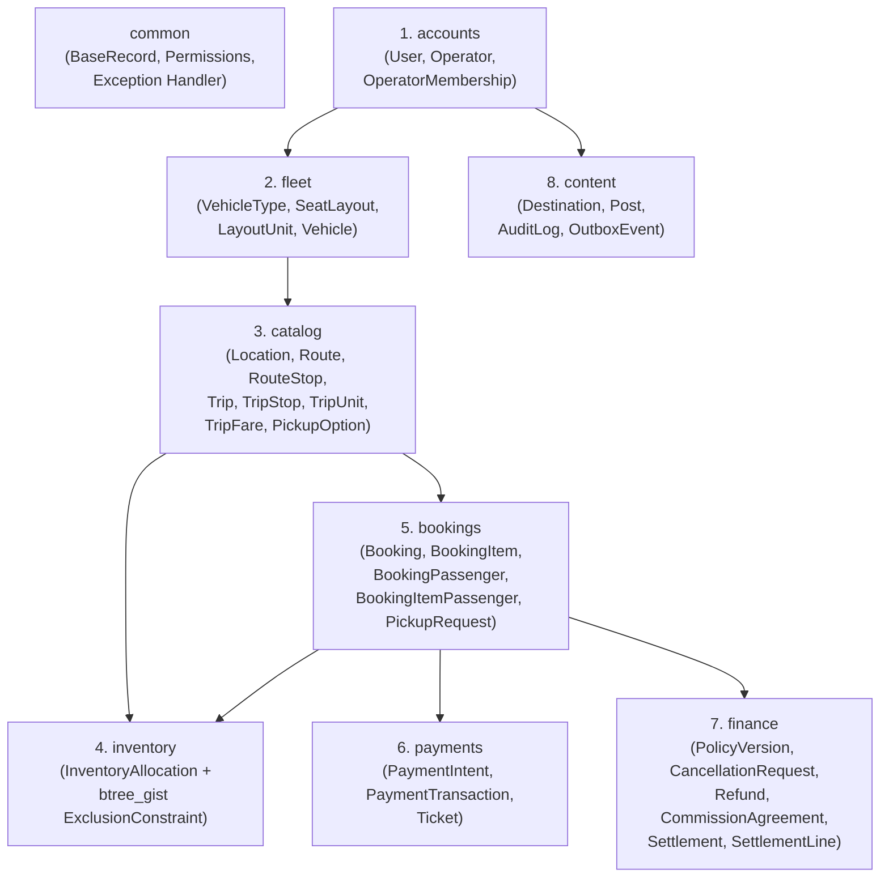

# 02 — KIỂM TOÁN KIẾN TRÚC DJANGO BACKEND & 8 APPS (DJANGO APPS AUDIT)

**Dự án:** RideWay – Vé Xuyên Việt  
**Thư mục Backend:** `c:\ProjectCV\RideWay\backend`  
**Framework:** Django 5.2.13 + Django REST Framework 3.16.0 + Psycopg 3.2.13  

---

## 1. ĐÁNH GIÁ VIỆC PHÂN TÁCH 8 DJANGO APPS & MODULE DÙNG CHUNG

Hệ thống Backend được chia thành **8 Django Apps theo đúng ranh giới Bounded Context** của DDD và 1 gói dùng chung `common`:

### Đánh giá kiến trúc phân tách App
- **Hợp lý, không cần tách thêm app mới:**
  - Sự phụ thuộc giữa các Models và migrations là **một chiều (DAG - không có vòng lặp circular dependency)**:
    - `accounts` là gốc định danh và multi-tenant (`User`, `Operator`).
    - `fleet` phụ thuộc `accounts`.
    - `catalog` phụ thuộc `accounts` và `fleet`.
    - `bookings` phụ thuộc `accounts` và `catalog`.
    - `inventory` phụ thuộc `catalog` (`TripUnit`) và `bookings` (`BookingItem`).
    - `payments` và `finance` phụ thuộc `bookings` và `accounts`.
    - `content` chỉ phụ thuộc `accounts` (`User`).
  - Mọi chức năng đề xuất bổ sung (quản lý tài xế, phân công chuyến, lịch chạy định kỳ, khiếu nại hỗ trợ, log thông báo) đều có thể mở rộng tự nhiên vào các app hiện hữu (`fleet`, `catalog`, `content`, `finance`) mà **không cần sinh thêm app mới**.

---

## 2. BẢNG ĐỐI CHIẾU TỔNG HỢP 8 DJANGO APPS

| STT | Django App | Số bảng PG | Models | URL Prefix | Serializers | Services | Permissions sử dụng | Migrations | Unit/Int Tests | Trạng thái tổng thể |
|---|---|---|---|---|---|---|---|---|---|---|
| 0 | `common` | 0 (Abstract) | `BaseRecord` | N/A | Không có | `api_error`, `custom_exception_handler`, `get_active_operator_ids` | Định nghĩa 4 class (`IsPlatformAdmin`, `IsPlatformStaffOrAdmin`, `IsOperatorMember`, `IsOperatorManagerOrOwner`) | Không | Không | **Đã có mã nguồn** |
| 1 | `accounts` | 3 | `User`, `Operator`, `OperatorMembership` | `/api/v1/` ([accounts/urls.py](file:///c:/ProjectCV/RideWay/backend/accounts/urls.py)) | Không có (xử lý dict trực tiếp) | Trong view | `AllowAny`, `IsAuthenticated`, `IsPlatformAdmin` | `0001_initial.py` + `seed_demo_data.py` | Gián tiếp qua `bookings/tests.py` | **Chưa hoàn thiện (Lỗi P0 lộ token)** |
| 2 | `fleet` | 4 | `VehicleType`, `SeatLayout`, `LayoutUnit`, `Vehicle` | `/api/v1/` ([fleet/urls.py](file:///c:/ProjectCV/RideWay/backend/fleet/urls.py)) | Không có | Trong view | `AllowAny`, `IsPlatformAdmin`, `IsOperatorMember` | `0001_initial.py` | Gián tiếp qua `bookings/tests.py` | **Chưa hoàn thiện (Thiếu khóa sửa sơ đồ đã gắn chuyến)** |
| 3 | `catalog` | 8 | `Location`, `Route`, `RouteStop`, `Trip`, `TripStop`, `TripUnit`, `TripFare`, `PickupOption` | `/api/v1/` ([catalog/urls.py](file:///c:/ProjectCV/RideWay/backend/catalog/urls.py)) | Không có | Trong view | `AllowAny`, `IsPlatformAdmin`, `IsOperatorMember` | `0001_initial.py` | `T07` trong `bookings/tests.py` | **Chưa hoàn thiện (Lỗi P0 tìm kiếm & giá theo chặng)** |
| 4 | `inventory` | 1 | `InventoryAllocation` | Không có URL trực tiếp | Không có | [inventory/services.py](file:///c:/ProjectCV/RideWay/backend/inventory/services.py) (`reclaim_expired_holds`) | Nội bộ qua service | `0001_enable_btree_gist.py`, `0002_initial.py` | `T01`–`T04` trong `bookings/tests.py` | **Đã kiểm thử thành công (Thiếu worker chạy nền)** |
| 5 | `bookings` | 5 | `Booking`, `BookingItem`, `BookingPassenger`, `BookingItemPassenger`, `PickupRequest` | `/api/v1/` ([bookings/urls.py](file:///c:/ProjectCV/RideWay/backend/bookings/urls.py)) | Không có | [bookings/services.py](file:///c:/ProjectCV/RideWay/backend/bookings/services.py) | `IsAuthenticated`, `IsOperatorMember`, `IsOperatorManagerOrOwner` | `0001_initial.py` | [bookings/tests.py](file:///c:/ProjectCV/RideWay/backend/bookings/tests.py) (`T01`–`T12`) | **Đã kiểm thử phần lõi (Cần bổ sung validate tuổi trẻ em & hạn báo giá)** |
| 6 | `payments` | 3 | `PaymentIntent`, `PaymentTransaction`, `Ticket` | `/api/v1/` ([payments/urls.py](file:///c:/ProjectCV/RideWay/backend/payments/urls.py)) | Không có | [payments/services.py](file:///c:/ProjectCV/RideWay/backend/payments/services.py) | `AllowAny` (IPN), `IsAuthenticated`, `IsOperatorMember` | `0001_initial.py` | `T05` trong `bookings/tests.py` | **Chưa hoàn thiện (Lỗi P0 QR token hash & URL VNPay thật)** |
| 7 | `finance` | 6 | `PolicyVersion`, `CancellationRequest`, `Refund`, `CommissionAgreement`, `Settlement`, `SettlementLine` | `/api/v1/` ([finance/urls.py](file:///c:/ProjectCV/RideWay/backend/finance/urls.py)) | Không có | [finance/services.py](file:///c:/ProjectCV/RideWay/backend/finance/services.py) | `IsAuthenticated`, `IsOperatorManagerOrOwner`, `IsPlatformAdmin` | `0001_initial.py` | `T11`, `T12` trong `bookings/tests.py` | **Chưa hoàn thiện (Lỗi P0 chưa nhả chỗ khi duyệt hủy vé)** |
| 8 | `content` | 4 | `Destination`, `Post`, `AuditLog`, `OutboxEvent` | `/api/v1/` ([content/urls.py](file:///c:/ProjectCV/RideWay/backend/content/urls.py)) | Không có | Trong view | `AllowAny`, `IsPlatformAdmin` | `0001_initial.py` | Chưa có test riêng | **Chưa hoàn thiện (`OutboxEvent` chưa được kích hoạt)** |

---

## 3. PHÂN TÍCH CHI TIẾT TỪNG APP & 10 NHÓM NGHIỆP VỤ

### 3.1. App `accounts` (Nhóm 1: Accounts & Authentication + Nhóm 2: Operators & Staff)
- **Models & Bảng PostgreSQL ([accounts/models.py](file:///c:/ProjectCV/RideWay/backend/accounts/models.py#L1-L68)):**
  - `User` → bảng `users` (UUID PK, `email` unique, `phone`, `full_name`, `email_verified_at`, `is_active`, `is_staff`, `is_superuser`).
  - `Operator` → bảng `operators` (`name`, `tax_code`, `status` trong `PENDING`/`ACTIVE`/`SUSPENDED`).
  - `OperatorMembership` → bảng `operator_memberships` (`user`, `operator`, `role` trong `OWNER`/`MANAGER`/`CHECKIN`, `is_active`, `UniqueConstraint('operator', 'user', name='uq_operator_user')`).
- **API Endpoints ([accounts/urls.py](file:///c:/ProjectCV/RideWay/backend/accounts/urls.py#L1-L34)):**
  - `GET /api/v1/auth/csrf`, `POST /api/v1/auth/register`, `POST /api/v1/auth/login`, `POST /api/v1/auth/logout`
  - `POST /api/v1/auth/password-reset/request`, `POST /api/v1/auth/password-reset/confirm`
  - `POST /api/v1/auth/email-verification/request`, `POST /api/v1/auth/email-verification/confirm`
  - `GET /api/v1/me`, `PATCH /api/v1/me/profile`, `GET /api/v1/me/operators`
  - `GET/POST /api/v1/admin/operators`, `PATCH /api/v1/admin/operators/<id>/status`, `POST /api/v1/admin/operators/<id>/memberships`
- **Chức năng đã hoàn thiện:**
  - Đăng ký, đăng nhập bằng email + mật khẩu sử dụng Django session cookie + CSRF token.
  - Cô lập đa nhà xe (Multi-tenant isolation) qua `get_active_operator_ids()` hỗ trợ chọn hãng qua header `X-Operator-Id` ([common/__init__.py](file:///c:/ProjectCV/RideWay/backend/common/__init__.py#L48-L63)).
- **Lỗi & Rủi ro kỹ thuật:**
  1. **[P0 - Lỗ hổng chiếm quyền tài khoản (Account Takeover)]** Tại [accounts/views.py](file:///c:/ProjectCV/RideWay/backend/accounts/views.py#L89-L92), `PasswordResetRequestView.post` trả về `{"detail": "...", "uid": uid, "token": token}` ngay trong HTTP response cho bất kỳ ai gửi email của nạn nhân. Tương tự tại [accounts/views.py](file:///c:/ProjectCV/RideWay/backend/accounts/views.py#L121-L127), `EmailVerificationRequestView.post` trả thẳng `uid` và `token` ra JSON.
  2. **[P1 - Thiếu kiểm tra độ mạnh mật khẩu theo chuẩn Django]** `RegisterView` ([accounts/views.py](file:///c:/ProjectCV/RideWay/backend/accounts/views.py#L34)) và `PasswordResetConfirmView` ([L103](file:///c:/ProjectCV/RideWay/backend/accounts/views.py#L103)) chỉ kiểm tra `len(password) < 8`, bỏ qua bộ `AUTH_PASSWORD_VALIDATORS` (`UserAttributeSimilarityValidator`, `CommonPasswordValidator`, `NumericPasswordValidator`) đã khai báo trong `settings.py`.
  3. **[P1 - Chưa cho phép Chủ hãng xe (`OWNER`) tự quản lý nhân viên của hãng]** Hiện chỉ có `AdminOperatorMembershipCreateView` (`IsPlatformAdmin`) tạo được membership; `OWNER` của hãng xe chưa có API thêm/vô hiệu hóa nhân viên `MANAGER`/`CHECKIN` thuộc hãng mình.

---

### 3.2. App `fleet` (Nhóm 3: Fleet & Vehicles)
- **Models & Bảng PostgreSQL ([fleet/models.py](file:///c:/ProjectCV/RideWay/backend/fleet/models.py#L1-L82)):**
  - `VehicleType` → `vehicle_types` (`code` unique, `name`).
  - `SeatLayout` → `seat_layouts` (`operator`, `name`, `deck_count` với `CheckConstraint` 1..2).
  - `LayoutUnit` → `layout_units` (`layout`, `unit_code`, `kind` trong `CABIN`/`BERTH`, `deck`, `row_number`, `column_number`, `price_mode`, `max_adults`, `max_children`; `UniqueConstraint('layout', 'unit_code')`).
  - `Vehicle` → `vehicles` (`operator`, `type`, `layout`, `registration`, `is_active`; `UniqueConstraint('operator', 'registration')`).
- **API Endpoints ([fleet/urls.py](file:///c:/ProjectCV/RideWay/backend/fleet/urls.py#L1-L14)):**
  - `GET /api/v1/vehicle-types`, `POST /api/v1/admin/vehicle-types`
  - `GET/POST /api/v1/operators/me/vehicles`
  - `GET/POST /api/v1/operators/me/layouts`
  - `GET/POST /api/v1/operators/me/layouts/<layout_id>/units`
- **Lỗi & Rủi ro kỹ thuật:**
  1. **[P1 - Thiếu kiểm tra bất biến sơ đồ đã gắn chuyến]** Theo đặc tả API (`Add unit to unused layout`), khi một `SeatLayout` đã được dùng để sinh `TripUnit` cho các chuyến xe, không được phép sửa/thêm `LayoutUnit` làm lệch cấu trúc. Hiện `OperatorLayoutUnitsView.post` ([fleet/views.py](file:///c:/ProjectCV/RideWay/backend/fleet/views.py#L88-L106)) chưa kiểm tra điều kiện này.
  2. **[P1 - Thiếu UniqueConstraint tọa độ `(layout, deck, row_number, column_number)`]** Hai `LayoutUnit` khác mã (`P01`, `P02`) có thể bị tạo trùng cùng tầng, cùng hàng, cùng cột trong cùng một sơ đồ xe.
  3. **[P1 - Rủi ro lỗi 500 `KeyError`]** `OperatorVehiclesView.post` ([fleet/views.py](file:///c:/ProjectCV/RideWay/backend/fleet/views.py#L48-L51)) truy cập trực tiếp `request.data['type_id']`, `request.data['layout_id']`, `request.data['registration']` không qua DRF Serializer; nếu client gửi thiếu trường sẽ văng `KeyError` (HTTP 500) thay vì HTTP 400.

---

### 3.3. App `catalog` (Nhóm 4: Routes & Trips)
- **Models & Bảng PostgreSQL ([catalog/models.py](file:///c:/ProjectCV/RideWay/backend/catalog/models.py#L1-L157)):**
  - `Location` → `locations`
  - `Route` → `routes`
  - `RouteStop` → `route_stops` (`UniqueConstraint('route', 'sequence')`)
  - `Trip` → `trips` (`Index('status', 'departure_at')`, `Index('route')`)
  - `TripStop` → `trip_stops` (`UniqueConstraint('trip', 'sequence')`)
  - `TripUnit` → `trip_units` (`UniqueConstraint('trip', 'unit_code')`)
  - `TripFare` → `trip_fares` (`CheckConstraint(to_sequence > from_sequence)`, `CheckConstraint(base_amount > 0)`, `UniqueConstraint('trip', 'from_sequence', 'to_sequence', 'unit_kind')`)
  - `PickupOption` → `pickup_options` (`CheckConstraint(fee >= 0 OR fee IS NULL)`)
- **API Endpoints ([catalog/urls.py](file:///c:/ProjectCV/RideWay/backend/catalog/urls.py#L1-L21)):**
  - `GET /api/v1/locations`, `POST /api/v1/admin/locations`
  - `GET /api/v1/trips`, `GET /api/v1/trips/<trip_id>/units`
  - `GET/POST /api/v1/operators/me/routes`, `GET/POST /api/v1/operators/me/routes/<route_id>/stops`
  - `GET/POST /api/v1/operators/me/trips`, `GET/POST /api/v1/operators/me/trips/<trip_id>/fares`, `PATCH /api/v1/operators/me/trips/<trip_id>/status`
  - `GET/POST /api/v1/operators/me/pickup-options`
  - `GET /api/v1/admin/trips`
- **Lỗi & Rủi ro kỹ thuật:**
  1. **[P0 - Lỗi lọc sai chiều điểm đi/điểm đến và sai giá theo chặng trong `TripSearchView`]** Tại [catalog/views.py](file:///c:/ProjectCV/RideWay/backend/catalog/views.py#L46-L87):
     - Khi truyền cả `from_location_id` và `to_location_id`, truy vấn không kiểm tra điểm đi có `sequence` nhỏ hơn điểm đến hay không, cũng không kiểm tra `allow_pickup=True` tại điểm đi và `allow_dropoff=True` tại điểm đến.
     - `min_price=Min('tripfare__base_amount')` lấy giá thấp nhất của toàn bộ bảng `trip_fares` thuộc chuyến đó (ví dụ chặng ngắn Huế → Đà Nẵng 150.000đ) ngay cả khi khách đang tìm chặng Hà Nội → TP.HCM (1.150.000đ).
     - Kết quả trả về của `/api/v1/trips` cũng chưa trả kèm `from_sequence`, `to_sequence` tương ứng với `from_location_id` và `to_location_id` để Frontend tự động nạp sơ đồ chỗ theo đúng chặng đã tìm!
  2. **[P1 - Chưa khóa chỉnh sửa `RouteStop` và `TripFare` khi chuyến đã `OPEN`]** `OperatorRouteStopsView.post` ([catalog/views.py](file:///c:/ProjectCV/RideWay/backend/catalog/views.py#L170-L183)) và `OperatorTripFaresView.post` ([L252-L270](file:///c:/ProjectCV/RideWay/backend/catalog/views.py#L252-L270)) chưa kiểm tra trạng thái `trip.status == 'DRAFT'` hoặc sự tồn tại của `from_sequence`/`to_sequence` trong `TripStop`.

---

### 3.4. App `inventory` (Nhóm 5: Seat Inventory)
- **Models & Bảng PostgreSQL ([inventory/models.py](file:///c:/ProjectCV/RideWay/backend/inventory/models.py#L1-L49)):**
  - `InventoryAllocation` → `inventory_allocations` (`trip_unit`, `booking_item`, `section = IntegerRangeField()`, `status` trong `HELD`/`CONFIRMED`/`RELEASED`/`EXPIRED`/`BLOCKED`, `expires_at`).
  - Ràng buộc PostgreSQL GIST: `ExclusionConstraint(name='exclude_active_unit_sections', expressions=[('trip_unit', RangeOperators.EQUAL), ('section', RangeOperators.OVERLAPS)], condition=Q(status__in=['HELD', 'CONFIRMED', 'BLOCKED']))`.
- **Services ([inventory/services.py](file:///c:/ProjectCV/RideWay/backend/inventory/services.py#L1-L21)):**
  - `reclaim_expired_holds(now=None)`: chuyển các `InventoryAllocation` có `status='HELD', expires_at__lte=now` và `Booking` có `status='HOLDING', hold_expires_at__lte=now` sang `EXPIRED`.
- **Chức năng đã hoàn thiện & Kiểm thử:**
  - Đã kiểm thử thực tế trên PostgreSQL 16 (`T01`–`T04`).
- **Chức năng còn thiếu:**
  - Chưa có API cho Hãng xe/Admin khóa/mở khóa một phòng/giường bảo trì (`status='BLOCKED'`, `booking_item=None`).
  - Chưa có tiến trình chạy nền (periodic task / management command) gọi `reclaim_expired_holds()` định kỳ mỗi 30–60 giây.

---

### 3.5. App `bookings` (Nhóm 6: Bookings & Passengers)
- **Models & Bảng PostgreSQL ([bookings/models.py](file:///c:/ProjectCV/RideWay/backend/bookings/models.py#L1-L125)):**
  - `Booking` → `bookings` (`booking_code` unique, `customer`, `status`, `hold_expires_at`, `total_amount`, `currency`, `contact_email`, `contact_phone`, `idempotency_key` unique).
  - `BookingItem` → `booking_items` (`booking`, `trip_unit`, `from_sequence`, `to_sequence`, `adult_count`, `child_count`, `unit_price`, `child_surcharge`).
  - `BookingPassenger` → `booking_passengers` (`booking`, `full_name`, `passenger_type`, `birth_date`, `phone`).
  - `BookingItemPassenger` → `booking_item_passengers` (`booking_item`, `passenger`, `UniqueConstraint('booking_item', 'passenger')`).
  - `PickupRequest` → `pickup_requests` (`booking_item`, `pickup_option`, `kind`, `custom_address`, `fee`, `status`).
- **Services ([bookings/services.py](file:///c:/ProjectCV/RideWay/backend/bookings/services.py#L1-L310)):**
  - `create_atomic_hold`, `assign_passengers_and_pickup`, `operator_quote_pickup`, `accept_booking_quote`.
- **Lỗi & Rủi ro kỹ thuật:**
  1. **[P1 - Xử lý `PickupRequest` cho kiểu `ZONE` và gắn với `BookingItem`]** Trong `assign_passengers_and_pickup` ([bookings/services.py](file:///c:/ProjectCV/RideWay/backend/bookings/services.py#L222-L246)), điều kiện `if kind == 'FIXED' and opt_id:` bỏ sót trường hợp khách chọn `PickupOption` có `kind == 'ZONE'`. Ngoài ra mọi `PickupRequest` đang chỉ gắn vào `first_item` thay vì gắn hoặc tính phí rõ theo đơn/mục đặt.
  2. **[P1 - Báo giá điểm đón riêng (`operator_quote_pickup`) không kiểm tra hạn giữ chỗ]** Tại [bookings/services.py](file:///c:/ProjectCV/RideWay/backend/bookings/services.py#L262-L291), nhân viên hãng xe vẫn có thể báo giá cho một đơn mà `hold_expires_at` đã hết hạn.

---

### 3.6. App `payments` (Nhóm 7: Payments & Tickets)
- **Models & Bảng PostgreSQL ([payments/models.py](file:///c:/ProjectCV/RideWay/backend/payments/models.py#L1-L78)):**
  - `PaymentIntent` → `payment_intents` (`booking`, `provider`, `amount`, `status`, `provider_reference`, `qr_payload`, `expires_at`; `UniqueConstraint('provider', 'provider_reference')`).
  - `PaymentTransaction` → `payment_transactions` (`intent`, `provider_event_id`, `amount`, `status`, `raw_payload`, `processed_at`; `UniqueConstraint('intent', 'provider_event_id')`).
  - `Ticket` → `tickets` (`booking_item` OneToOne, `code` unique, `qr_token_hash` unique, `status` trong `ISSUED`/`CHECKED_IN`/`CANCELLED`, `issued_at`, `checked_in_at`, `checked_in_by`).
- **Lỗi & Rủi ro kỹ thuật:**
  1. **[P0 - Lỗi kiến trúc bảo mật mã QR vé (`qr_token` vs `qr_token_hash`)]** Tại [payments/services.py](file:///c:/ProjectCV/RideWay/backend/payments/services.py#L174-L194):
     - Lúc xuất vé trong `process_vnpay_ipn`, hệ thống sinh `raw_token = f"{booking.booking_code}:{item.id}:{uuid.uuid4().hex}"`, lưu `hashlib.sha256(raw_token.encode()).hexdigest()` vào `Ticket.qr_token_hash`, nhưng không lưu hay ký số để khách hàng lấy được `raw_token`.
     - Trong `MyTicketsView.get` ([payments/views.py](file:///c:/ProjectCV/RideWay/backend/payments/views.py#L84)), API lại trả chính `qr_token_hash` ra ngoài JSON, và `check_in_ticket` ([payments/services.py](file:///c:/ProjectCV/RideWay/backend/payments/services.py#L190-L193)) có đoạn `if len(qr_token) == 64: token_hash = qr_token` cho phép dùng trực tiếp bản băm trong DB để check-in!
     - **Cách sửa chuẩn:** Sử dụng chữ ký HMAC (`django.core.signing.Signer` hoặc HMAC-SHA256 từ `SECRET_KEY` trên định danh vé `ticket.code` + `ticket.id`) để tạo `qr_token` trả cho chủ vé, trong khi DB chỉ lưu `qr_token_hash = sha256(qr_token)` và `check_in_ticket` bắt buộc luôn băm `sha256(qr_token)` để tra cứu.
  2. **[P0 - Kiểm tra chữ ký và số tiền IPN VNPay]** Trong `process_vnpay_ipn` ([payments/services.py](file:///c:/ProjectCV/RideWay/backend/payments/services.py#L102-L108)), điều kiện `if 'vnp_Amount' in params:` là tùy chọn; nếu kẻ tấn công hoặc request thiếu trường `vnp_Amount`, hệ thống bỏ qua bước đối chiếu số tiền! Phải bắt buộc có mặt `vnp_Amount` và `vnp_TransactionStatus == '00'`.

---

### 3.7. App `finance` (Nhóm 8: Finance & Settlements)
- **Models & Bảng PostgreSQL ([finance/models.py](file:///c:/ProjectCV/RideWay/backend/finance/models.py#L1-L129)):**
  - `PolicyVersion` → `policy_versions`
  - `CancellationRequest` → `cancellation_requests`
  - `Refund` → `refunds`
  - `CommissionAgreement` → `commission_agreements`
  - `Settlement` → `settlements`
  - `SettlementLine` → `settlement_lines`
- **Lỗi & Rủi ro kỹ thuật:**
  1. **[P0 - Duyệt hủy vé không giải phóng chỗ và không hủy vé điện tử]** Trong `AdminCancellationDecisionView.post` ([finance/views.py](file:///c:/ProjectCV/RideWay/backend/finance/views.py#L162-L188)), khi `decision == 'APPROVED'`, hệ thống chưa:
     - Chuyển `InventoryAllocation` của các `BookingItem` thuộc đơn đó từ `CONFIRMED` sang `RELEASED`.
     - Chuyển `Ticket` thuộc đơn đó từ `ISSUED` sang `CANCELLED` (chỉ cho phép hủy khi vé chưa `CHECKED_IN`).
     - Chuyển `Booking.status` sang `CANCELLED` (hoặc `REFUNDED`).
  2. **[P1 - Chưa có service tổng hợp kỳ đối soát (`Settlement` generation)]** Hiện tại bảng `Settlement` chỉ có dữ liệu từ `seed_demo_data.py` và API `GET /admin/settlements` + `POST /admin/settlements/<id>/approve`. Chưa có API `POST /api/v1/admin/settlements/generate` để tự động gom các `BookingItem` đã hoàn tất trong kỳ `[period_start, period_end]` chưa được đối soát vào `Settlement` và `SettlementLine`.

---

### 3.8. App `content` (Nhóm 9: Content Management + Nhóm 10: Administration & Audit)
- **Models & Bảng PostgreSQL ([content/models.py](file:///c:/ProjectCV/RideWay/backend/content/models.py#L1-L55)):**
  - `Destination` → `destinations`
  - `Post` → `posts`
  - `AuditLog` → `audit_logs`
  - `OutboxEvent` → `outbox_events`
- **Lỗi & Rủi ro kỹ thuật:**
  1. **[P1 - Bảng `OutboxEvent` chưa được nối vào luồng giao dịch]** Các giao dịch quan trọng (đăng ký/xác minh email, khôi phục mật khẩu, giữ chỗ, phát hành vé sau IPN, duyệt hủy/hoàn tiền) chưa tạo bản ghi `OutboxEvent` và chưa có command/worker gửi email thông báo.
  2. **[P1 - Báo cáo tổng hợp Admin (`AdminReportSummaryView`) chưa lọc theo khoảng thời gian]** Tại [content/views.py](file:///c:/ProjectCV/RideWay/backend/content/views.py#L112-L132), `GET /api/v1/admin/reports/summary` mới tính tổng toàn thời gian, chưa hỗ trợ lọc theo `from_date`, `to_date`, `operator_id`.
