# 07 — KẾ HOẠCH PHÁT TRIỂN & LỘ TRÌNH HOÀN THIỆN HỆ THỐNG (IMPROVEMENT ROADMAP)

**Dự án:** RideWay – Vé Xuyên Việt  
**Mục tiêu:** Đưa hệ thống từ bản MVP hiện tại lên hệ thống Production-Ready đạt chuẩn bảo mật, toàn vẹn dữ liệu giao dịch theo chặng, đầy đủ tính năng vận hành đa nhà xe và trải nghiệm người dùng hoàn chỉnh.

---

## 1. TỔNG QUAN LỘ TRÌNH 3 GIAI ĐOẠN (P0 → P1 → P2)

```mermaid
flowchart LR
    subgraph P0["GIAI ĐOẠN P0 (Bắt buộc trước vận hành)"]
        P0_1["TASK-P0-01: Vá lỗ hổng lộ Token\nPassword Reset & Email Verify"]
        P0_2["TASK-P0-02: Sửa TripSearchView\nChiều chạy & Giá đúng chặng"]
        P0_3["TASK-P0-03: Mã hóa HMAC QR Vé\n& Check-in chuẩn SHA-256"]
        P0_4["TASK-P0-04: Duyệt hủy vé giải phóng\nInventoryAllocation & Ticket"]
        P0_5["TASK-P0-05: Hoàn thiện IPN VNPay\n(vnp_Amount + Late Webhook T06)"]
        P0_6["TASK-P0-06: DRF Serializers,\nException Handler & Rate Limiting"]
    end

    subgraph P1["GIAI ĐOẠN P1 (Vận hành hoàn chỉnh)"]
        P1_1["TASK-P1-01: Transactional Outbox\n& Worker dọn Hold quá hạn"]
        P1_2["TASK-P1-02: Phân quyền Platform Staff\n& Quản lý Khiếu nại (SupportTicket)"]
        P1_3["TASK-P1-03: Quản lý Tài xế (Driver),\nPhân công & Sinh chuyến định kỳ"]
        P1_4["TASK-P1-04: Tự động sinh Kỳ đối soát\n& Ràng buộc DB bổ sung"]
        P1_5["TASK-P1-05: Tích hợp React Router v7,\nRedux Toolkit & RTK Query"]
        P1_6["TASK-P1-06: Hoàn thiện UI 4 Portals\n(Tìm kiếm ngày, QR SVG, CRUD Hãng/Admin)"]
    end

    subgraph P2["GIAI ĐOẠN P2 (Mở rộng & Tối ưu)"]
        P2_1["TASK-P2-01: Đặt vé khứ hồi\n(Round-Trip Booking)"]
        P2_2["TASK-P2-02: Đổi chuyến/Đổi chỗ\n(Ticket Change Workflow)"]
        P2_3["TASK-P2-03: Khuyến mãi & Mã giảm giá\n(Voucher/Promo Engine)"]
        P2_4["TASK-P2-04: Đánh giá chuyến đi\n& Tuyến yêu thích"]
    end

    P0 --> P1 --> P2
```

---

## 2. GIAI ĐOẠN P0 — BẮT BUỘC TRƯỚC KHI VẬN HÀNH (BLOCKERS & SECURITY / DATA INTEGRITY)

**Mục tiêu giai đoạn P0:** Triệt tiêu 100% các lỗ hổng bảo mật nghiêm trọng, lỗi sai lệch giá/chiều tìm kiếm theo chặng, lỗi giữ nguyên tồn kho sau khi hủy vé và rủi ro đua tranh dữ liệu khi webhook thanh toán đến muộn.

| Mã công việc | Phân hệ | Tên hạng mục | Tác động cốt lõi |
|---|---|---|---|
| **TASK-P0-01** | `accounts`, `content` | Vá lỗ hổng lộ `uid`/`token` trong API Khôi phục mật khẩu & Xác minh Email | Chặn nguy cơ chiếm đoạt tài khoản (Account Takeover); chuyển token qua `OutboxEvent` / Email backend và áp dụng `validate_password()`. |
| **TASK-P0-02** | `catalog` | Sửa thuật toán tìm kiếm chuyến theo chặng & Tính giá thấp nhất đúng chặng `[from_seq, to_seq)` | Đảm bảo chỉ trả về chuyến xe đi đúng chiều `from_stop.sequence < to_stop.sequence`, có `allow_pickup=True`/`allow_dropoff=True`, và `min_price` là giá của đúng đoạn chặng khách tìm (`BR-05`). |
| **TASK-P0-03** | `payments` | Chuẩn hóa bảo mật mã QR vé điện tử (`qr_token` ký số HMAC vs `qr_token_hash` SHA-256) | Không bao giờ trả `qr_token_hash` trong DB ra API `/me/tickets`; sinh `qr_token` ký số HMAC cho chủ vé và bắt buộc `check_in_ticket` luôn băm SHA-256 khi đối chiếu. |
| **TASK-P0-04** | `finance`, `inventory`, `payments`, `bookings` | Giải phóng tồn kho `InventoryAllocation` & Hủy `Ticket` khi duyệt yêu cầu hủy vé | Khi `AdminCancellationDecisionView` duyệt `APPROVED`, tự động chuyển `InventoryAllocation` sang `RELEASED`, `Ticket` sang `CANCELLED` và `Booking` sang `CANCELLED` trong cùng transaction. |
| **TASK-P0-05** | `payments`, `inventory` | Củng cố xác thực VNPay IPN (`vnp_Amount` bắt buộc) & Bắt `IntegrityError` cho Late Webhook (`T06`) | Bắt buộc kiểm tra số tiền `vnp_Amount == intent.amount * 100`, sinh URL thanh toán VNPay chuẩn HMAC-SHA512, và bọc `try/except IntegrityError` khi khôi phục hold quá hạn để chuyển an toàn sang `PAID_CONFLICT_PENDING_REFUND`. |
| **TASK-P0-06** | `common`, toàn bộ 8 apps | Bổ sung DRF Input Serializers, Rate Limiting (Throttling) & Khóa chỉnh sửa Sơ đồ/Điểm dừng đã gắn chuyến | Ngăn lỗi `KeyError`/`ValueError` 500 khi thiếu trường dữ liệu; chống brute-force `/auth/login` và spam `/holds`; chặn thêm ghế vào sơ đồ đã sử dụng. |

### Tiêu chí thoát giai đoạn P0 (Exit Criteria)
1. Không còn bất kỳ endpoint nào trả `token` mật khẩu/xác minh email trong HTTP response.
2. Toàn bộ 12 kịch bản kiểm thử `T01`–`T12` và 16 hợp đồng `API-01`–`API-16` chạy pass 100% trên PostgreSQL 16 thật.
3. Tìm kiếm chặng `Hà Nội (0) → Đà Nẵng (2)` trả về đúng `from_sequence=0, to_sequence=2` và `min_price` của đúng đoạn `[0, 2)`, đồng thời không trả về các chuyến chạy chiều ngược lại `Đà Nẵng → Hà Nội`.
4. Sau khi Admin duyệt hủy một đơn đã thanh toán, các phòng/giường của đơn đó trên đoạn `[from_seq, to_seq)` lập tức mở bán trở lại cho khách khác đặt thành công.

---

## 3. GIAI ĐOẠN P1 — HOÀN THIỆN VẬN HÀNH & TRẢI NGHIỆM ĐA VAI TRÒ (OPERATIONAL EXCELLENCE)

**Mục tiêu giai đoạn P1:** Hoàn thiện đầy đủ công cụ vận hành hàng ngày cho Hãng xe, Nhân viên nền tảng (`Platform Staff`), Quản trị viên (`Platform Admin`) và nâng cấp kiến trúc Frontend với React Router + Redux Toolkit + RTK Query.

| Mã công việc | Phân hệ | Tên hạng mục | Tác động cốt lõi |
|---|---|---|---|
| **TASK-P1-01** | `content`, `inventory`, `bookings`, `payments` | Kích hoạt Transactional Outbox (`OutboxEvent`) & Tiến trình chạy nền thu hồi Hold quá hạn | Tự động gửi email xác nhận vé, báo giá đón trả, khôi phục mật khẩu và tự động chuyển các đơn giữ chỗ quá 10 phút sang `EXPIRED` mỗi 60 giây. |
| **TASK-P1-02** | `common`, `bookings`, `content`, `finance` | Phân quyền `Platform Staff` (`S-01`) & Module Quản lý Khiếu nại / Hỗ trợ (`SupportTicket`) | Đưa `IsPlatformStaffOrAdmin` vào vận hành thực tế: nhân viên nền tảng xử lý yêu cầu hủy vé, đơn thanh toán trễ xung đột, bài viết CMS và phiếu hỗ trợ khách hàng (`support_tickets`). |
| **TASK-P1-03** | `fleet`, `catalog` | Quản lý Tài xế (`Driver`), Phân công Chuyến xe & Công cụ Sinh chuyến định kỳ hàng loạt | Hãng xe quản lý hồ sơ tài xế (GPLX, hạn bằng), gán tài xế/xe cho chuyến có kiểm tra chống trùng lịch, và tạo lịch chạy định kỳ hàng ngày/tuần. |
| **TASK-P1-04** | `finance`, `fleet` | Tự động tổng hợp Kỳ đối soát (`Settlement` Generator) & Bổ sung Ràng buộc CSDL nâng cao | Tự động gom các `BookingItem` đã hoàn thành trong kỳ vào `Settlement` + `SettlementLine` (đảm bảo mỗi `BookingItem` chỉ đối soát 1 lần qua `uq_settlement_line_booking_item`). |
| **TASK-P1-05** | `frontend` | Tích hợp `react-router-dom` v7, `@reduxjs/toolkit` & RTK Query (`ridewayApi`) | Tách URL riêng cho từng màn hình (`/`, `/trips`, `/my-tickets`, `/operator/*`, `/staff/*`, `/admin/*`), tự động đồng bộ và làm mới cache dữ liệu sau mỗi thao tác. |
| **TASK-P1-06** | `frontend` | Hoàn thiện UI cho 4 Portals (Bộ lọc ngày đi, chọn `PickupOption`, QR SVG thật, CRUD Hãng xe/Admin) | Khách hàng chọn ngày đi, điểm đón trung chuyển và quét QR thật; Hãng xe tạo xe/sơ đồ/tuyến/chuyến/giá trên UI; Admin cấu hình hoa hồng, chính sách và duyệt bài viết. |

---

## 4. GIAI ĐOẠN P2 — CHỨC NĂNG MỞ RỘNG & TỐI ƯU THƯƠNG MẠI (GROWTH & EXTENSIONS)

**Mục tiêu giai đoạn P2:** Gia tăng tỷ lệ chuyển đổi, giá trị vòng đời khách hàng (LTV) và khả năng mở rộng quy mô lớn.

| Mã công việc | Phân hệ | Tên hạng mục | Tác động cốt lõi |
|---|---|---|---|
| **TASK-P2-01** | `bookings`, `frontend` | Đặt vé khứ hồi (Round-Trip Booking) trong cùng một phiên thanh toán | Cho phép khách chọn chuyến chiều đi + chuyến chiều về, giữ chỗ nguyên tử cả 2 lượt và thanh toán gộp qua 1 mã VNPay QR. |
| **TASK-P2-02** | `bookings`, `finance`, `inventory` | Luồng Đổi chuyến / Đổi vị trí phòng-giường tự động (`kind='CHANGE'`) | Thực thi nghiệp vụ đổi sang phòng/chuyến mới và bù/hoàn phần chênh lệch giá vé trong cùng một giao dịch nguyên tử. |
| **TASK-P2-03** | `finance`, `bookings`, `frontend` | Hệ thống Mã giảm giá & Khuyến mãi theo tuyến/hãng (`Promotion` / `Voucher`) | Hỗ trợ mã giảm giá theo `%` hoặc số tiền cố định khi đặt nhiều phòng đôi hoặc đặt sớm. |
| **TASK-P2-04** | `content`, `catalog`, `frontend` | Đánh giá chuyến đi (Verified Reviews), Tuyến yêu thích & Đề xuất chuyến thông minh | Chỉ khách đã `CHECKED_IN` mới được đánh giá chất lượng xe; lưu danh sách tuyến yêu thích của khách hàng. |
| **TASK-P2-05** | `docker-compose.yml`, CI/CD | Đóng gói Docker toàn trình (`backend`, `frontend`, `worker`, `postgres`) & GitHub Actions CI | Tự động chạy `manage.py test` trên PostgreSQL 16 service container và `tsc -b && vite build` trên mọi Pull Request. |
