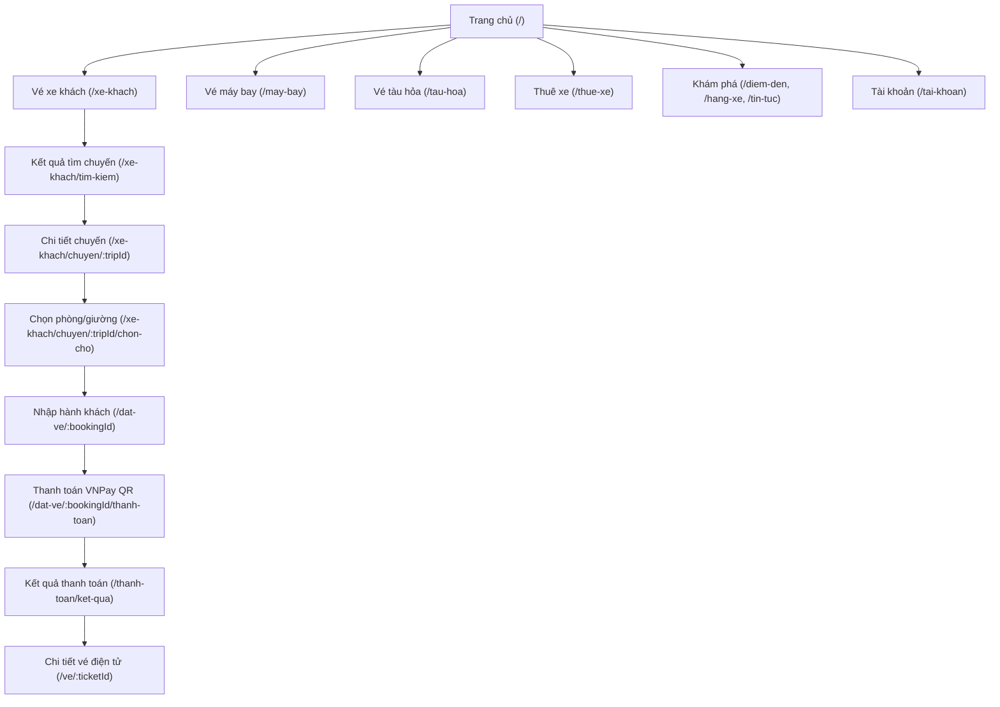

# 03 — SITEMAP & CẤU TRÚC ĐỊNH TUYẾN (SITEMAP AND ROUTES)

**Dự án:** RideWay – Vé Xuyên Việt  
**Công nghệ định tuyến:** React Router (`BrowserRouter`, Nested Layout Routes, Protected Routes)

---

## 1. Sơ đồ Kiến trúc Điều hướng Đa Trang

---

## 2. Danh mục Toàn bộ Routes của Hệ thống

### A. Khu vực Công khai (`PublicLayout`)

| Nhóm | Tên trang | Đường dẫn URL (`path`) | Component trang |
|---|---|---|---|
| Trang chủ | Trang chủ RideWay | `/` | `HomePage` |
| Xe khách | Trang giới thiệu & tìm vé xe khách | `/xe-khach` | `BusLandingPage` |
| Xe khách | Kết quả tìm kiếm & lọc chuyến xe | `/xe-khach/tim-kiem` | `BusSearchPage` |
| Xe khách | Chi tiết chuyến xe & lộ trình trạm | `/xe-khach/chuyen/:tripId` | `BusTripDetailPage` |
| Xe khách | Chọn phòng đôi / giường nằm 2 tầng | `/xe-khach/chuyen/:tripId/chon-cho` | `BusSeatSelectionPage` |
| Máy bay | Trang dịch vụ vé máy bay | `/may-bay` | `FlightsLandingPage` |
| Máy bay | Tra cứu & đăng ký nhu cầu chuyến bay | `/may-bay/tim-kiem` | `FlightsSearchPage` |
| Tàu hỏa | Trang dịch vụ vé tàu hỏa Bắc – Nam | `/tau-hoa` | `RailwaysLandingPage` |
| Tàu hỏa | Tra cứu & kết nối đối tác đường sắt | `/tau-hoa/tim-kiem` | `RailwaysSearchPage` |
| Thuê xe | Trang dịch vụ thuê xe hợp đồng & du lịch | `/thue-xe` | `RentalsLandingPage` |
| Thuê xe | Danh sách dòng xe cho thuê | `/thue-xe/danh-sach` | `RentalsListPage` |
| Thuê xe | Chi tiết dòng xe & gửi yêu cầu báo giá | `/thue-xe/:id` | `RentalDetailPage` |
| Hãng xe | Danh sách hãng xe đối tác trên sàn | `/hang-xe` | `OperatorsListPage` |
| Hãng xe | Chi tiết hãng xe & các chuyến mở bán | `/hang-xe/:slug` | `OperatorDetailPage` |
| Điểm đến | Danh mục điểm đến & bến xe toàn quốc | `/diem-den` | `DestinationsListPage` |
| Điểm đến | Chi tiết điểm đến & tuyến xe kết nối | `/diem-den/:slug` | `DestinationDetailPage` |
| Tin tức | Cẩm nang di chuyển & tin tức du lịch | `/tin-tuc` | `NewsListPage` |
| Tin tức | Chi tiết bài viết cẩm nang | `/tin-tuc/:slug` | `NewsDetailPage` |
| Thông tin | Giới thiệu nền tảng Vé Xuyên Việt | `/gioi-thieu` | `AboutPage` |
| Thông tin | Liên hệ & tổng đài hỗ trợ 24/7 | `/lien-he` | `ContactPage` |
| Thông tin | Điều khoản sử dụng sàn giao dịch | `/dieu-khoan` | `TermsPage` |
| Thông tin | Chính sách bảo mật & hoàn/hủy vé | `/chinh-sach` | `PolicyPage` |
| Xác thực | Đăng nhập tài khoản | `/dang-nhap` | `LoginPage` |
| Xác thực | Đăng ký tài khoản hành khách | `/dang-ky` | `RegisterPage` |
| Xác thực | Khôi phục mật khẩu | `/quen-mat-khau` | `ForgotPasswordPage` |
| Lỗi 404 | Trang không tìm thấy | `*` | `NotFoundPage` |

### B. Khu vực Đặt vé & Thanh toán (`PublicLayout` + `ProtectedRoute`)

| Tên trang | Đường dẫn URL (`path`) | Quyền truy cập | Component trang |
|---|---|---|---|
| Nhập thông tin hành khách & đón/trả | `/dat-ve/:bookingId` | Đã đăng nhập | `BookingCheckoutPage` |
| Thanh toán VNPay QR 100% | `/dat-ve/:bookingId/thanh-toan` | Đã đăng nhập | `BookingPaymentPage` |
| Kết quả đối chiếu thanh toán | `/thanh-toan/ket-qua` | Đã đăng nhập | `PaymentResultPage` |
| Chi tiết vé điện tử QR | `/ve/:ticketId` | Đã đăng nhập | `TicketDetailPage` |

### C. Khu vực Tài khoản Hành khách (`AccountLayout` + `ProtectedRoute`)

| Tên trang | Đường dẫn URL (`path`) | Quyền truy cập | Component trang |
|---|---|---|---|
| Hồ sơ cá nhân & bảo mật | `/tai-khoan` | Đã đăng nhập | `AccountProfilePage` |
| Lịch sử đơn đặt vé & vé điện tử | `/tai-khoan/don-hang` | Đã đăng nhập | `AccountOrdersPage` |
| Chi tiết đơn hàng & yêu cầu hủy/đổi | `/tai-khoan/don-hang/:id` | Đã đăng nhập | `AccountOrderDetailPage` |

### D. Khu vực Dashboard Hãng xe (`PartnerLayout` + `ProtectedRoute`)

| Tên trang | Đường dẫn URL (`path`) | Component trang |
|---|---|---|
| Tổng quan vận hành nhà xe | `/doi-tac` | `PartnerDashboardPage` |
| Đội xe & Sơ đồ chỗ 2 tầng | `/doi-tac/xe-va-so-do` | `PartnerVehiclesPage` |
| Quản lý tuyến đường & trạm dừng | `/doi-tac/tuyen-duong` | `PartnerRoutesPage` |
| Quản lý lịch chạy chuyến xe | `/doi-tac/chuyen-xe` | `PartnerTripsPage` |
| Bảng giá vé theo đoạn chặng | `/doi-tac/gia-ve` | `PartnerPricingPage` |
| Danh sách hành khách & Check-in QR | `/doi-tac/hanh-khach` | `PartnerPassengersPage` |
| Đơn đặt chỗ & Báo giá đón/trả riêng | `/doi-tac/don-dat-ve` | `PartnerBookingsPage` |
| Nhân sự nhà xe (Memberships) | `/doi-tac/nhan-vien` | `PartnerStaffPage` |
| Đối soát doanh thu & Chính sách hủy | `/doi-tac/bao-cao` | `PartnerReportsPage` |

### E. Khu vực Dashboard Quản trị Nền tảng (`AdminLayout` + `ProtectedRoute`)

| Tên trang | Đường dẫn URL (`path`) | Component trang |
|---|---|---|
| Tổng quan chỉ số toàn sàn | `/admin` | `AdminDashboardPage` |
| Quản lý & phê duyệt hãng xe | `/admin/hang-xe` | `AdminOperatorsPage` |
| Quản lý người dùng & phân quyền | `/admin/nguoi-dung` | `AdminUsersPage` |
| Giám sát toàn bộ chuyến xe | `/admin/chuyen-xe` | `AdminTripsPage` |
| Quản lý đơn & xử lý khiếu nại hủy vé | `/admin/don-dat-ve` | `AdminBookingsPage` |
| Giám sát giao dịch thanh toán & hoàn tiền | `/admin/thanh-toan` | `AdminPaymentsPage` |
| Đối soát kỳ thanh toán & hoa hồng sàn | `/admin/tai-chinh` | `AdminFinancePage` |
| Quản lý điểm đến & bài viết tin tức | `/admin/noi-dung` | `AdminContentPage` |
| Cấu hình danh mục bến xe & loại xe | `/admin/cau-hinh` | `AdminConfigPage` |
| Nhật ký kiểm toán bảo mật (Audit Logs) | `/admin/nhat-ky` | `AdminAuditLogsPage` |
